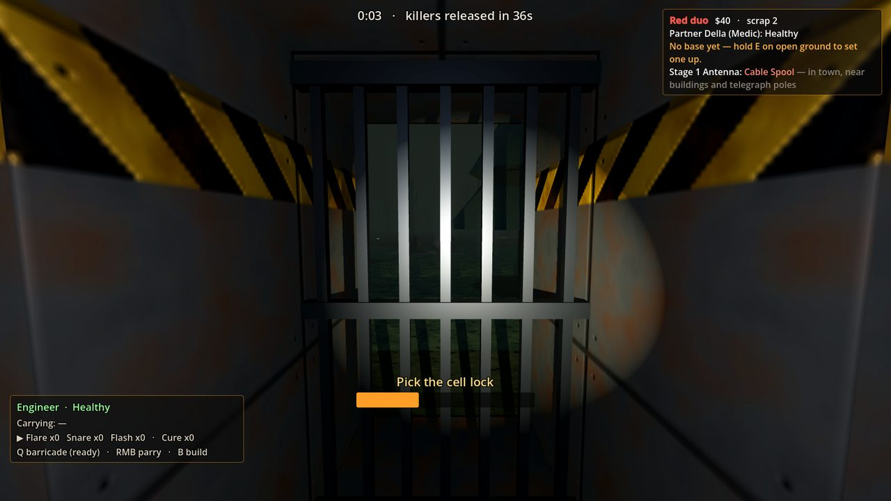
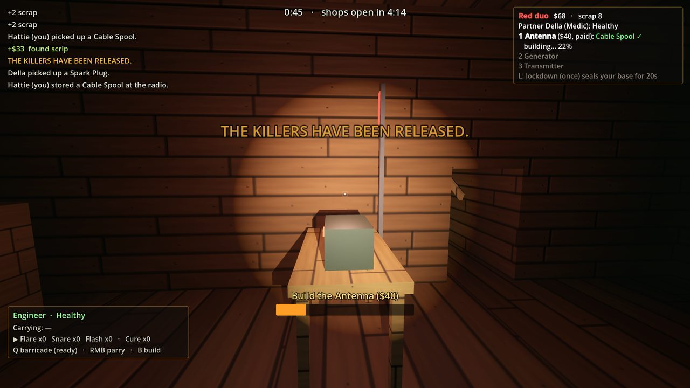
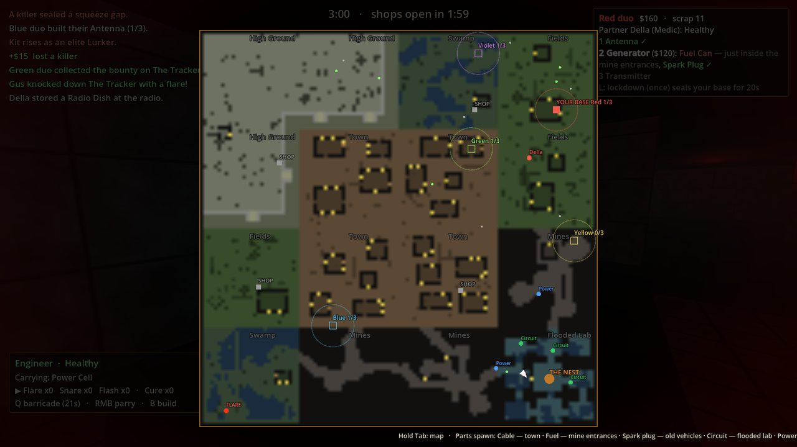
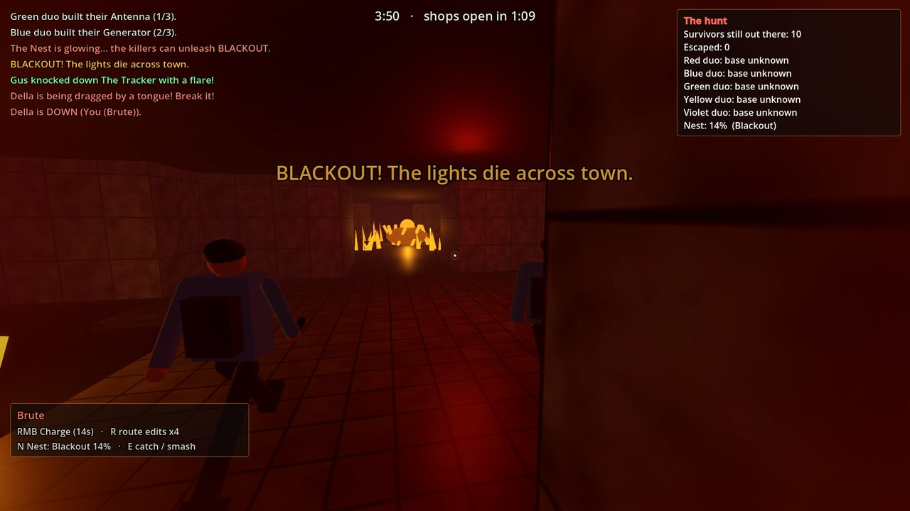
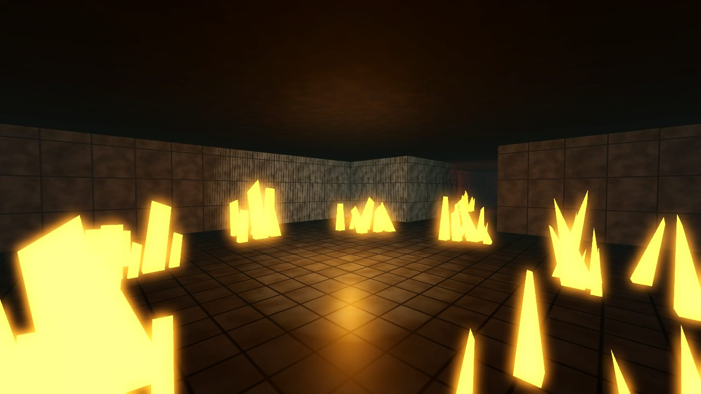
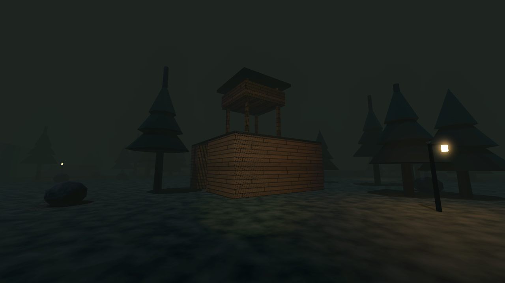
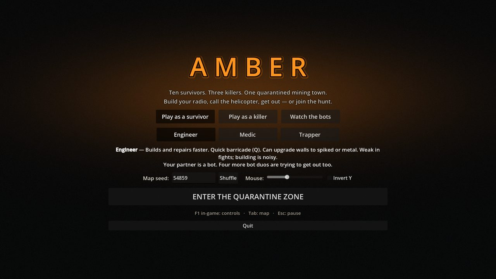

# Amber

A first-person asymmetric horror survival prototype in **Godot 4.7**, built from the *Amber* game design document.

There are five survivor duos (10 survivors) and 3 killers in a quarantined, procedurally shuffled mining town. Each duo escapes its cell, picks a spot for a base, scavenges radio parts and builds a 3-stage radio station, then calls a helicopter and boards it together. Caught survivors rise as elite infected on the killers' side.

You play one of the 13 slots, as a survivor or as a killer. Bots fill the rest. You can also watch a match played entirely by bots.



| | |
|---|---|
|  |  |
|  |  |
|  |  |

## Run it

1. Install **Godot 4.7** (standard build, not .NET) from <https://godotengine.org/download>. Any 4.7.x works.
2. Open Godot, choose **Import**, and select `amber/project.godot`.
3. Press **F5** (or the ▶ button). Pick a side on the title screen and click **Enter the quarantine zone**.

Everything is generated at runtime, so there are no assets to download. That includes the map, textures, character and prop models, and sound effects. The first launch spends a few seconds importing.

The project uses the **Compatibility** renderer, so it runs on most hardware. On a desktop GPU you can switch to **Forward+** in *Project Settings → Rendering → Renderer*. The game then turns on volumetric fog automatically.

## Controls

| | Survivor | Killer / elite |
|---|---|---|
| Move | WASD | WASD |
| Look | Mouse | Mouse |
| Run (noisy) / crouch (quiet, harder to see) | Shift / Ctrl or C | — |
| Interact (hold) | E: pick locks, pick up, set up base, build radio stages, heal, revive, cure, break tongues, shop, steal, hide, board | E: catch a downed survivor, smash boards and cell doors, search lockers, seal found hatches |
| Primary | LMB: use tool (1 flare gun, 2 snare, 3 flash trap) | LMB: attack (hold on walls and the radio to smash them) |
| Secondary | RMB: perfect parry (time it as the swing lands) | RMB: signature power |
| Role ability | Q: Engineer barricade, Medic scent mask, Trapper drop trap | — |
| Other | F flashlight · B build mode · L lockdown (once) · G give $25 to the poorest duo | R route edit · N unleash the Nest event |
| Map / pause / help | Tab · Esc · F1 | Tab · Esc · F1 |

**Build mode (B).** Choose a structure with the mouse wheel or 1–9, LMB to place, RMB to leave. Press H for the escape hatch (aim at a wall). Engineers press U (spikes) or M (metal) while aiming at their own wall or door.

## What's in

- **Procedural map.** Every match reshuffles districts on a 4×4 grid:
  - a foggy wooden town;
  - swamp;
  - fields;
  - mines with tunnels and deep shafts;
  - a flooded company lab where the Nest sits;
  - high ground with cliffs, ramps and a watchtower.

  The map also has survivor-only squeeze gaps, boarded passages, quarantine cells, exits, items and loot. Mines and the lab have ceilings, and town buildings have roofs.
- **Start.** No safe phase. Duos spawn locked in quarantine cells. One random duo gets the worse trap: a mine cell with two levers that must be held at the same time, compensated with extra money. Killers are released at 0:40. Smashing cell doors and boards opens them for everyone, and it's noisy.
- **Survivors.**
  - Two hits: the first wounds you and gives an adrenaline burst, the second downs you.
  - Downed survivors crawl. Reaching your own base adds 2 minutes before you turn.
  - Only cures (5 per match, one per person) or a Medic revive save you. If you turn inside your base, you reveal it to the killers.
  - Perfect parry has a 0.12 s window.
  - There are 4 flare guns (knockdown items). Survivors see them on the map; killers only see shifting hot zones.
- **Roles.** Engineer (fast builder, quick barricade, spiked and metal upgrades), Medic (fast heals, one revive, scent mask) and Trapper (more traps, snares, flash traps; killers get brief immunity after a trap).
- **Killers.** Each has a shared kit plus one signature power:
  - **Tracker:** goes invisible and fast but blind to survivors, follows footprints, blood and noise. The scent mask counters it.
  - **Brute:** charges through walls, turns badly, is stunned on a miss and stopped by metal walls.
  - **Lurker:** silent, with a long tongue grab that pulls a survivor in and holds them. A partner breaks the tongue. The Lurker is weak once spotted.
- **Economy.**
  - Each duo shares a money pot. Earn it from loot, trapping, stunning, parries, saving your partner, losing a killer in a chase, and bounties.
  - When a partner is caught, the duo's pot is halved and the lost half becomes a bounty on that killer.
  - Two of the four supply terminals open every 5 minutes.
- **Radio and escape.**
  - Stages: Antenna (cable spool), Generator (fuel can, spark plug), Transmitter (circuit board, power cell, radio dish). Each stage also costs money.
  - Calling the helicopter alerts the whole map. It arrives after 90 s and hovers while a killer holds the landing zone, for 30 s at most.
  - The duo then has 15 s to board.
- **Bases.** Walls, doors, barricades, alarms, floodlights, decoys, lockers and traps. Each duo also gets one hidden escape hatch and one 20-second lockdown. Killers siege and smash stations, and repairs cost money.
- **Betrayal and help.** You can steal parts stored at another duo's base, but it's slow and noisy, and anyone who sees it marks you as a thief. You can also send money to a struggling duo.
- **The Nest.** It fills from catches, base damage and radio progress, and jumps when a helicopter is called. The killers pick one event before the match: Blackout, Pulse, Swarm or Signal Jam. Each time it fires, main killers also regain a route-edit charge.
- **Route editing.** Killers have 3 charges to seal squeeze gaps and found hatches or collapse narrow mine tunnels. A collapse that would cut the map in two is refused.
- **Elites.** Caught survivors pick a class and level up through a 3-branch skill tree. Elites stay weaker than the main killers.
- **Bots for all 13 slots**, with Easy, Normal and Hard difficulty.
- **Atmosphere.** Fog, flickering lanterns, red emergency lights in the lab and glowing amber infection. A first-person flashlight with shadows. Killers see in the dark through a red haze. Procedural sound: heartbeat, footsteps, swings, roars, clangs, the helicopter rotor and the generator hum.

## Forge models

Every model is a named slot. Drop a `.glb`, `.gltf` or `.obj` exported from Forge (Kenney's Asset Forge exports glTF) into `assets/models/` with the slot's name, and it replaces the placeholder automatically, scaled to fit. The slot list is in [assets/models/README.md](assets/models/README.md).

## Not in this prototype

- **Online multiplayer.** You play against bots. Godot's high-level multiplayer API could carry it later; the match logic is already separated from rendering and input.
- **Art and animation.** Characters and props are built from primitives with procedural animation, and textures are procedural. Forge models drop in as described above.
- **Meta progression** (unlocks, perks, cosmetics). The GDD deferred it as well.

## Tuning and design notes

- **Tuning.** Every balance number is in [`scripts/core/tuning.gd`](scripts/core/tuning.gd).
- **Design notes.** [DESIGN-NOTES.md](DESIGN-NOTES.md) lists:
  - every place where the design doc was ambiguous and the default chosen;
  - answers to the doc's open questions;
  - balance results from the bot simulations.

## Testing tools

```bash
# headless all-bot matches (prints the event log and a summary)
godot --headless --path amber --script res://scripts/tests/sim.gd -- --seeds=1,2,3 --log

# a map as ASCII, plus reachability checks for every item and cell
godot --headless --path amber --script res://scripts/tests/mapgen_test.gd -- --seeds=1,2 --ascii

# play a match on autopilot and save first-person screenshots at given match times
godot --path amber -- --play=survivor --role=0 --seed=11 --autopilot --shots=/tmp/shots --times=3,45,100

# capture the menus and panels
godot --path amber -- --ui_demo=/tmp/ui

# soak test: a whole match fast-forwarded with the HUD, map and autopilot running (survivor, killer or watch)
godot --headless --path amber -- --soak=killer --killer=1 --seed=9
```

## Project layout

```
amber/
  project.godot, scenes/main.tscn
  scripts/core/     defs.gd (enums, names), tuning.gd (all numbers), game.gd (autoload: settings, CLI args)
  scripts/world/    map_gen.gd, map_data.gd, nav.gd (A*), world_view.gd (3D build), mats.gd (procedural
                    textures), models.gd + object_models.gd (model slots and placeholders)
  scripts/game/     match.gd (main loop, events), interact.gd (hold-E actions), bases.gd (radio, heli,
                    structures, betrayal), shop_sys.gd, nest_sys.gd, heli.gd, structure.gd, item_pickup.gd,
                    slot.gd, duo.gd, base.gd
  scripts/actors/   actor.gd (grid movement, collision, squeeze gaps, animation), survivor.gd, killer.gd
  scripts/ai/       survivor_ai.gd, killer_ai.gd
  scripts/player/   player_controller.gd (first-person camera, input, build mode, spectating)
  scripts/ui/       hud.gd, map_view.gd, main_menu.gd
  scripts/audio/    sfx.gd (synthesised sound)
  scripts/tests/    sim.gd, mapgen_test.gd, view_test.gd
  assets/models/    drop Forge exports here
```
